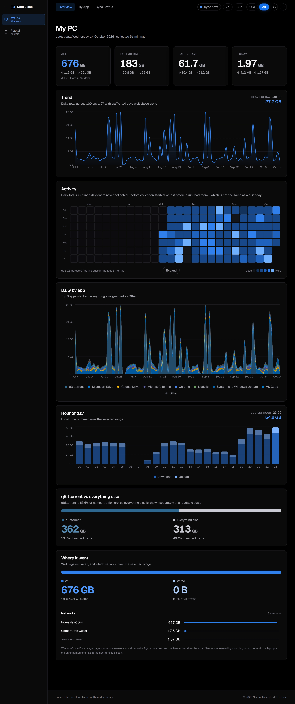
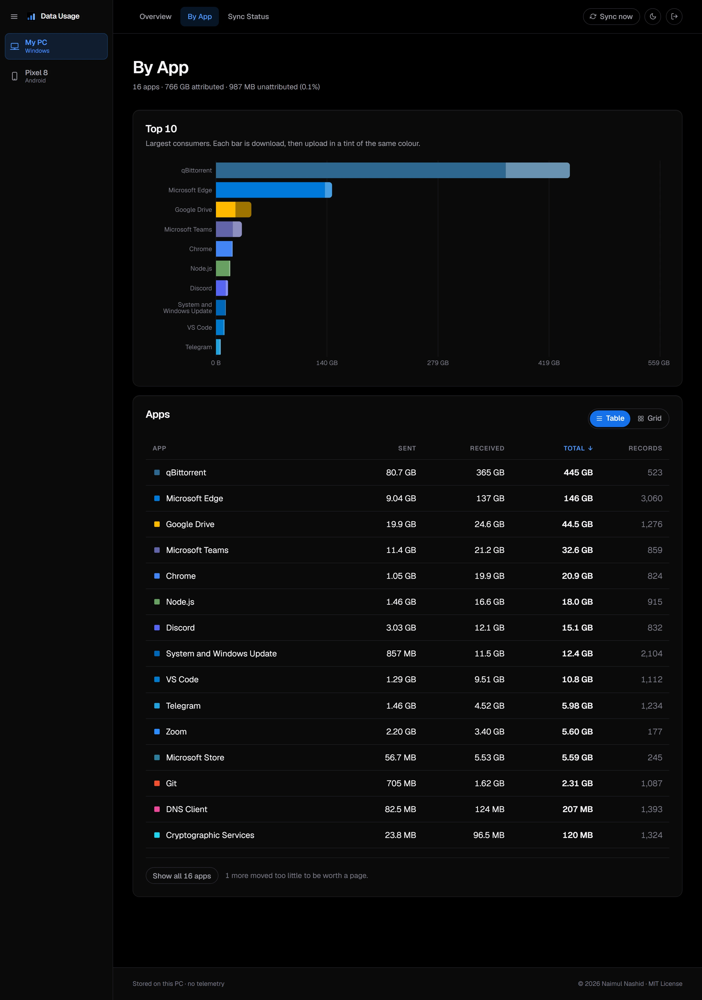
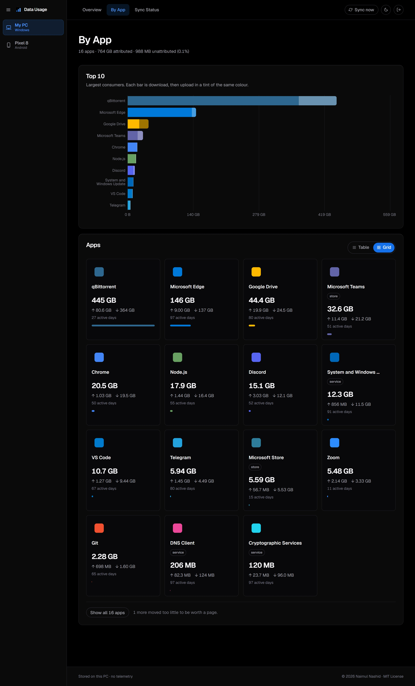
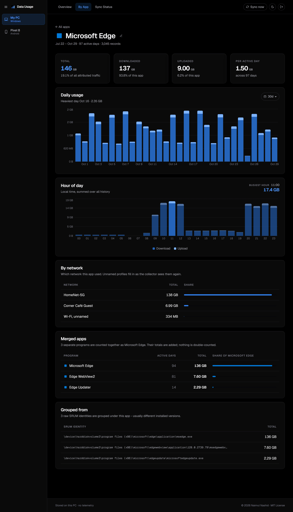
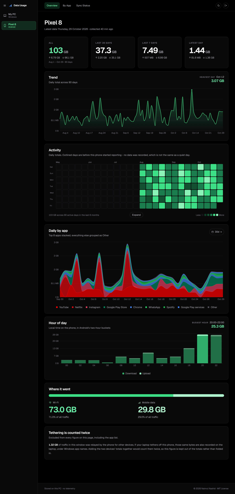
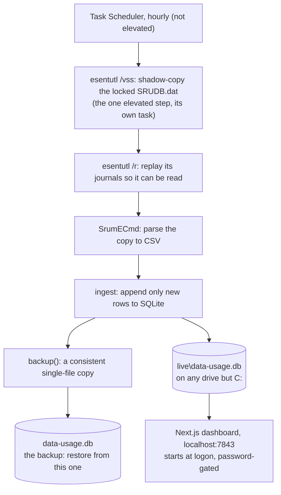
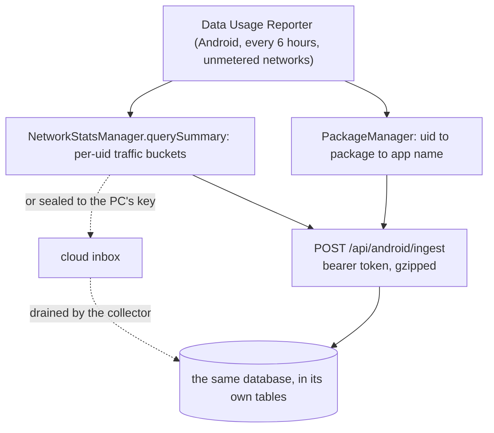

#  Data Usage Tracker

[](https://github.com/naimulnashid/data-usage-tracker/actions/workflows/ci.yml)
[](https://github.com/naimulnashid/data-usage-tracker/releases/latest)
[](LICENSE)
[](https://data-usage-tracker-site.vercel.app/)

A local dashboard that makes per-app network usage history **permanent**, for a
Windows PC and, optionally, Android phones.

Windows already tracks how much data each app uses (Settings → Network &
internet → Data usage), but it keeps only about 30 to 60 days, in a database on
the OS partition. **A Windows reset wipes it.** Android keeps about 90 days, and
only an app on the device can read it per app.

This project copies both into a SQLite database on a drive that survives a
reset, and shows them in a Next.js dashboard that runs on your own machine.
**[See it on the project site](https://data-usage-tracker-site.vercel.app/)**:
how it works, every chart it draws (live, on invented data) and every feature.

- **Local only.** The history stays on your PC: no account, no telemetry.
  The one optional outbound connection is the phones' end-to-end encrypted
  cloud inbox; without it nothing leaves your network. The dashboard listens
  on `127.0.0.1` unless you open it to your network.
- **Windows 10/11.** The collector reads SRUM, the database behind Windows' own
  Data usage page.
- **A personal tool, shared as is.** It is built and used on one machine, and
  depends on Windows internals and a third-party parser. Expect to read the
  scripts before trusting them with your data.

## Screenshots

> **Every number in these images is invented.** They are captured from
> `npm run demo:data`, a synthetic history loaded through the real collector and
> phone code, by `npm run demo:shots`; see [Development](#development). No logos
> ship, so apps show their colour swatch, as they will on a fresh install until
> you add some. Each image follows your GitHub theme.

The whole Windows overview: totals, the daily trend with its spike days marked,
a six-month heat map (outlined days were never collected, which is not the same
as a quiet day), each day split by app, the hour of day, one heavy app set
apart from the rest, and where it went, network by network.

<picture>
  <source media="(prefers-color-scheme: light)" srcset="docs/screenshots/windows-overview-light.webp">
  
</picture>

<details>
<summary><b>Every app as a table or a grid, one app in detail, and a phone</b></summary>

Every app, ranked. Each bar is download, then upload in a tint of the app's
own colour.

<picture>
  <source media="(prefers-color-scheme: light)" srcset="docs/screenshots/windows-apps-light.webp">
  
</picture>

The same list as a grid of cards.

<picture>
  <source media="(prefers-color-scheme: light)" srcset="docs/screenshots/windows-apps-grid-light.webp">
  
</picture>

One app in detail: the networks it used, named as the collector sees them
and "unnamed" until it has, and the separate programs merged into it.

<picture>
  <source media="(prefers-color-scheme: light)" srcset="docs/screenshots/windows-app-detail-light.webp">
  
</picture>

A phone, in its own accent, with tethering kept apart: the laptop has already
counted those bytes.

<picture>
  <source media="(prefers-color-scheme: light)" srcset="docs/screenshots/android-overview-light.webp">
  
</picture>

</details>

## Features

- **A permanent history of every app's traffic** on the PC, read from SRUM
  every hour and appended to SQLite on another drive, deduplicated so a re-run
  inserts nothing. A consistent single-file backup is written beside it.
- **Overview**: all-time, 30-day, 7-day and latest-day totals with upload and
  download; the daily trend with every day well above trend marked; a six-month
  heat map, expandable to the full history; daily usage by the top eight apps
  with its own 7d / 30d / 90d / All menu; hour of day; an optional "one app vs
  everything else" split; and **where it went**, Wi-Fi against wired with each
  network on a ring, named by watching which network the PC is on.
- **By App**: the top 10 as download/upload bars, and every app as a sortable
  table or a grid of cards. **Hide** an app you do not want listed (every total
  still counts it), or **merge** one app into another and separate it again.
- **App detail** for every app with a shape worth a page: daily usage with its
  own range menu and the heaviest day, hour of day, traffic by network, the
  programs merged into it, and the raw SRUM identities behind it.
- **Rename any app and choose its colour**, stored with the history.
- **Names Windows would show**: versioned install paths, versioned store
  packages and service names fold into one app each.
- **Sync Status**: whether collection is running, the run history, and a
  warning when it has stopped.
- **Android phones (optional)**: a dependency-free reporter app sends per-app
  traffic every 6 hours on unmetered networks, straight to the dashboard or
  through an end-to-end encrypted cloud inbox; each phone gets the same pages,
  with tethering kept out of its totals.
- **Light and dark themes**, an installable web app, Backspace to go back
  from a detail page, and keyboard-reachable controls throughout.
- **Reset recovery** you can rehearse without resetting: `npm run drill`.

## Installation and getting started

### Requirements

- **Windows 10 or 11**, and **Administrator rights once**, to register the
  scheduled tasks. Only the shadow copy runs elevated, from an admin-owned copy
  of one small script; the collector and the dashboard run as you.
- **Node.js 22.16 or newer** (the `engines` field; developed on Node 24). The
  database is Node's built-in `node:sqlite`, so there is no native build step.
- **[SrumECmd](https://ericzimmerman.github.io/)**, downloaded yourself; it is
  not bundled or fetched automatically. It needs a **.NET runtime**; if it will
  not start on the one you have, set `DOTNET_ROLL_FORWARD=Major`.
- **A second drive or partition** for the database. It must not be on `C:\`;
  the collector refuses.

For the phone (optional):

- **Android 8.0 or newer** (`minSdk` 26, `targetSdk` 36).
- **adb** to install the app, and a JDK and the Android SDK to build it yourself.

**Downloads.** The PC side runs from a clone of this repository: it is a set of
scheduled scripts and a Next.js server, so there is no installer to download.
The Android app is attached as a signed APK to
[releases](https://github.com/naimulnashid/data-usage-tracker/releases) that
carry one.

All commands below run from the repository root, in PowerShell unless a step
says otherwise.

### 1. Install

```bash
npm install
```

Then set the paths and the password; see [Configuration](#configuration).

### 2. Register the tasks, and collect

From an **Administrator PowerShell**, once:

```bash
powershell -ExecutionPolicy Bypass -File scripts\register-task.ps1 -RunNow
```

This registers two tasks and runs a first collection:

- **Data Usage Collector**: hourly, catching up if the machine was off.
  It runs **unelevated**: it parses, ingests, backs up and cleans up.
- **Data Usage Snapshot**: elevated, on demand, and started only by the
  collector. It takes the shadow copy of the locked SRUM database and nothing
  else. It runs a copy of `scripts\srum-snapshot.ps1` that registration places in
  a folder only administrators can write, never the repo's copy. **After
  editing that script, re-run this command.**

That folder also holds the ~99 MB snapshot between runs, so it is
`DataUsageTracker-snapshot` at the root of your database's drive, not on C:
(`-DeployRoot` picks another; it falls back to `%ProgramData%\DataUsageTracker`
when that drive is not NTFS). An hourly 99 MB copy is about 2.4 GB a day of
writes, which the system drive, often the smallest and fullest, is better
off without.

It also writes both task definitions to `scripts\task\` as a record. They
contain your Windows account ID and paths, so they are git-ignored; keep them
with your backups rather than in a public fork.

After this, a collection needs no elevation, from any shell. It is safe to
re-run; a second pass over the same window inserts nothing:

```bash
powershell -ExecutionPolicy Bypass -File scripts\collector.ps1
```

### 3. Start the dashboard at logon

```bash
powershell -ExecutionPolicy Bypass -File scripts\install-autostart.ps1
```

This registers a logon task that starts the dashboard hidden, so
<http://localhost:7843> is simply there. No admin rights needed. It also
registers a small task that notes which Wi-Fi network you are on every 15
minutes, which is how network profiles get their names. To start the dashboard
now:

```bash
wscript scripts\dashboard-hidden.vbs
```

**Build after changing anything it serves.** The launcher builds only when there
is no build at all; otherwise it serves what is on disk, and
`logs\dashboard.log` warns when that is older than the source:

```bash
npm run build
```

### 4. Add an Android phone (optional)

Set `ANDROID_INGEST_TOKEN` and `DASHBOARD_HOST=0.0.0.0` (see
[Configuration](#configuration)), then install the app. The simplest way is the
signed APK attached to the newest
[release](https://github.com/naimulnashid/data-usage-tracker/releases) that
carries one:

```bash
adb install -r data-usage-reporter-1.5.2.apk
```

Or build it yourself (see [Development](#development)).

On Xiaomi's MIUI, `adb install` is refused unless Developer options → **Install
via USB** is on; without that, `adb push` the APK to the phone and install it
from the file manager.

Android only lets an APK update an installed copy signed with the same key. So
switching between the release APK and your own build means uninstalling first,
and so does moving from the debug-signed 1.2 to 1.3 or later. Nothing already
uploaded is lost, and the app re-sends the phone's history on its first sync,
but the reinstalled app reports under a **new device id**, so the phone shows
up twice. After it has synced once, fold the old entry into the new one:

```bash
npm run android:merge
```

lists the phones with their ids and app versions;
`npm run android:merge -- --from <old id> --into <new id>` shows what would
move, and adding `--apply` backs the database up beside your backup and merges.

If the install still fails after uninstalling ("package conflicts with an
existing package"), a copy is left in another profile such as Private Space,
Dual Apps or a work profile, or the uninstall kept the app's data. With the
phone on USB, `adb uninstall com.naimul.datausage` removes it for every user.

On the phone, open **Data Usage Reporter** and:

1. Enter the dashboard address and the token, then **Save and test
   connection**. Use this PC's LAN address (`ipconfig` shows it, for example
   `http://192.168.1.20:7843`), not `localhost`, which on a phone is the phone.
2. Press **Grant usage access** and switch it on in Settings. Android never
   prompts for this, and without it the app silently reports only its own
   traffic.
3. **Android 9 and older:** press **Grant phone permission**. Those versions
   read mobile data per SIM, which needs it; the app will not sync without it
   rather than silently record no mobile data.
4. Press **Sync now** once, then leave it. It syncs every 6 hours on unmetered
   networks; both are adjustable in the app.

**Never add a phone's total to the PC's.** Tethering (uid `-5`) is traffic the
phone relayed for other devices; if this PC tethers off the phone, those bytes
are in both. The dashboard keeps tethering out of the phone's totals.

## Configuration

Two files, both outside version control in a real install.

**[config/collector.json](config/collector.json)** holds the paths; the shipped
file is the example, with placeholders:

| Key | What it is |
|---|---|
| `databasePath` | The working database. **Not on `C:\`.** |
| `backupPath` | The consistent backup, next to it. This is what you restore from. |
| `scratchDir` | A working folder for the ~99 MB snapshot and CSVs mid-run. Keep it outside any cloud-synced folder, or every run uploads your raw history. |
| `srumECmdDir` | The folder holding `SrumECmd.exe`. |
| `deviceLabel` | What the dashboard calls this machine; also its URL (`/windows/<slug>`). |
| `splitApp` | Optional. One app, as the dashboard names it (for example `"qBittorrent"`), to show against everything else on the Overview, for a machine where one app dwarfs the rest. `null` for none. |
| `inbox` | Optional. The cloud inbox's `url` and `keyPath`; see below. |

If you want an offsite copy, point a sync client (OneDrive, Google Drive and so
on) at the folder holding `backupPath`.

**`.env.local`** holds the secrets. Copy [.env.example](.env.example), which
documents each one, and fill it in:

| Variable | What it is |
|---|---|
| `DASHBOARD_PASSWORD` | Required, **at least 12 characters**. The dashboard **fails closed**: with no password, or a short one, it refuses every request. Wrong guesses are throttled; changing it signs out every device. |
| `DASHBOARD_HOST` | Optional. Unset, the dashboard answers only on `127.0.0.1`. `0.0.0.0` opens it to your network, which the phone app needs. |
| `ANDROID_INGEST_TOKEN` | Optional, for phones: the bearer token the app sends. Separate from the password, so the password never lives on a phone. Fails closed too. |
| `INBOX_DRAIN_TOKEN` | Optional, for the cloud inbox: the PC's own token, written by `npm run inbox -- drain-token`. |
| `DATA_USAGE_CONFIG` | Optional. Points the dashboard (only) at another `collector.json`, as the demo does. |

```bash
DASHBOARD_PASSWORD=choose-something-long
```

With `DASHBOARD_HOST=0.0.0.0`, allow Node.js through Windows Firewall on
**Private** networks only. It is plain HTTP behind the password, so keep it off
networks you do not trust. Windows' first prompt for Node.js usually allows
**Public** networks too; after marking your home network **Private**, run
`npm run firewall` once from an Administrator shell to block port 7843 on
Public networks.

### Optional: a cloud inbox, so the phone can report from anywhere

On its own the phone posts straight to the dashboard, so it must be on the
PC's network, the PC must be on, and the address changes whenever the router
hands the PC a new one. A **cloud inbox** removes all three: the phone posts
to a fixed `https://` address on any network, and the PC collects whatever is
waiting when it next runs. Android keeps ~90 days, so nothing is lost while
the PC is off either way; the inbox only stops the waiting.

**The inbox cannot read what it holds.** The app encrypts each upload to a
key that only the PC has (P-256 ECDH, AES-256-GCM), and mixes your ingest
token into the key derivation, so the inbox cannot forge one either. It sees
an envelope's size, its time and the phone's random device id. The format is
written out at the top of `src/lib/inbox.ts`.

It runs on Supabase's free tier, as one Edge Function and two tables. The
same function serves the sibling Screen Time Tracker as a separate mailbox,
so one free project covers both:

1. Create a Supabase project. Run `supabase/migrations/*.sql` in order in its
   SQL editor, and deploy `supabase/functions/inbox` with **JWT verification off**
   (the function checks its own tokens):
   `supabase functions deploy inbox --no-verify-jwt`.
2. In `config/collector.json`, set
   `"inbox": { "url": "https://<project>.supabase.co/functions/v1/inbox", "keyPath": "D:\\keys\\inbox-key.pem" }`.
   Keep the key off `C:\` and out of the repo, and back it up: envelopes still
   in the inbox cannot be opened without it.
3. Create the key and the PC's own token, then register both tokens:
   ```bash
   npm run inbox -- keygen
   npm run inbox -- drain-token
   npm run inbox -- sql
   ```
   Run the SQL that the last one prints in the SQL editor. It holds SHA-256
   digests only.
4. Rebuild and restart the dashboard. On the phone, at home, press **Set up
   cloud inbox from the dashboard**. The app fetches the inbox address and the
   PC's key over the LAN (never from the inbox, which could swap the key) and
   shows the key's fingerprint; `npm run inbox -- key` prints the same one.

The hourly collector empties the inbox at the end of each run, or run
`npm run inbox -- drain` yourself. The Sync page marks an upload that came
this way with when it reached the database. An envelope that cannot be opened
stays in the inbox, marked failed; fix the cause, then
`npm run inbox -- drain --retry-failed`, or press **Full resync** on the phone.
A free Supabase project pauses after a week with no requests; the phones'
uploads keep it awake, and the Supabase dashboard restores it if not.

## Usage

| Page | Shows |
|---|---|
| **Overview** | All / 30 days / 7 days / latest day, the daily trend, a six-month heat map, daily usage by app, hour of day, and where it went: Wi-Fi against wired, network by network |
| **By App** | Every app with enough activity for a detail page, expandable to every app seen, as a table or a grid; click a Top 10 bar or a card to open that app |
| **App detail** | One app's daily and hourly usage, networks, and which programs were grouped into it |
| **Sync Status** | Collector run history, with warnings when it has stopped; jump to any page, or straight to the newest or oldest |
| **Phone pages** | The same views for each phone |

**Every page covers all history.** Daily by app and an app's Daily usage each
have a 7d / 30d / 90d / All menu at their top right, opening on 30d.
**Sync now** in the top bar runs a collection on demand.

**Your own names, colours and groupings.** On By App, the "..." beside an
app's name opens **Rename or recolour…** (a colour picked, or typed as a hex
code), hides the app from By App, or merges it into another app; on an app's
own page the pencil beside its name renames it. A merged
app is then counted as part of that app everywhere, and its detail page's
Merged apps card separates it again. All of these are stored in the database
with the history.

**Light or dark.** The sun/moon menu in the top bar switches between a dark
theme, a light theme, or following your system. It is remembered per browser,
as is By App's table or grid.

**Totals will not match Windows' page exactly, and that is expected.** Windows
scopes its page to one network; the dashboard counts all of them. Compare
Windows' figure with that network's row under "Where it went" on the Overview.

**Watch Sync Status.** Surviving a reset depends on the collector actually
running; that page is where you notice it has stopped.

Per-network phone traffic is not available to apps; `npm run android:ssid`
reads it over USB into the database. The phone pages do not show it at present.

### Install as an app

The dashboard is an installable web app: its own window, taskbar icon and
Start-menu entry, with no browser chrome. In Chrome or Edge, open
<http://localhost:7843> and choose **Install** in the address bar (or the
menu's *Install Data Usage*).

**Installing needs a secure context**: `localhost`, `127.0.0.1`, or HTTPS.
Over plain HTTP on the LAN, a phone's browser offers at most a home-screen
shortcut that opens in a tab. To install on an Android phone anyway, add the
dashboard's LAN address (e.g. `http://192.168.0.10:7843`) to
`chrome://flags/#unsafely-treat-insecure-origin-as-secure` on that phone and
relaunch Chrome.

The app caches nothing but a "dashboard unreachable" page, shown when the
computer running it is asleep or off. Your usage data is never stored in the
browser.

### Everyday commands

| | |
|---|---|
| Report from the command line | `npm run stats` (add `-- --profile <id>` to scope to one network, as Windows' page is) |
| Stop the dashboard | Double-click `stop-dashboard.bat`, or `powershell -ExecutionPolicy Bypass -File scripts\dashboard-stop.ps1` |
| Turn off autostart | `powershell -ExecutionPolicy Bypass -File scripts\install-autostart.ps1 -Remove` |
| Remove the collector tasks | `powershell -ExecutionPolicy Bypass -File scripts\register-task.ps1 -Unregister` (Administrator) |
| Logs | `logs\collector-*.log`, `logs\dashboard.log` |

### Recovery after a Windows reset

A reset erases `C:\`: the repo, Node, SrumECmd, SRUM itself and the scheduled
tasks. Your database drive survives. Rehearse the whole recovery at any time,
without resetting anything, with `npm run drill`.

1. Install [Node.js](https://nodejs.org), [Git](https://git-scm.com),
   [SrumECmd](https://ericzimmerman.github.io/) and a .NET runtime.
2. Check your database folder is intact. If you synced it offsite, let it sync
   back down first.
3. Clone this repo anywhere, then `npm install`, and restore
   `config/collector.json` if you had changed it.
4. Restore the database from the backup:

   ```bash
   npm run restore
   ```

   This copies the backup over the working database, never the reverse. An
   existing database is kept beside it first, as a complete single-file copy
   (`.replaced-<time>`), and stale `-wal`/`-shm` files are cleared. It refuses
   to run while the dashboard or a collector has the database open, so stop
   them first.
5. Recreate `.env.local`. **If you use the phone app, restore
   `ANDROID_INGEST_TOKEN` to its old value**; the phone has the old one, and
   otherwise stops syncing without saying so here.
6. Re-register the tasks, the collector pair from an Administrator PowerShell,
   the dashboard from a normal one. Re-run the scripts rather than importing
   the saved XML: that XML names the old install's account, and the snapshot
   script has to be redeployed.

   ```bash
   powershell -ExecutionPolicy Bypass -File scripts\register-task.ps1 -RunNow
   ```

   ```bash
   powershell -ExecutionPolicy Bypass -File scripts\install-autostart.ps1
   ```

7. Check with `npm run stats`, then open <http://localhost:7843>.

SRUM starts empty on a fresh install. Your history comes from the restored
database, and the collector appends to it from there.

## Tech stack and architecture

- **Collector**: PowerShell scripts run by Task Scheduler; Windows' own
  `esentutl` for the shadow copy and journal replay;
  [SrumECmd](https://ericzimmerman.github.io/) to parse SRUM; a TypeScript
  ingester (`scripts/ingest.ts`, run with `tsx`).
- **Database**: SQLite through Node's built-in `node:sqlite`, in WAL mode, with
  a `backup()` copy for restores.
- **Dashboard**: Next.js 15 (App Router), React 19, TypeScript, Recharts and
  the Geist typeface; a password gate in the middleware, Web Crypto sessions.
- **Phone app**: Kotlin on Android's public `NetworkStatsManager`, with no
  dependencies; JobScheduler, `HttpURLConnection` and views built in code.
- **Cloud inbox (optional)**: one Supabase Edge Function and two tables.



The phone half is optional and independent:



The phone app reads Android's public API rather than parsing `adb` output,
because the raw dump counts every byte that crossed a VPN twice.

The reasoning behind all of this, including the traps that shaped it (SRUM's
per-interface total row that doubles every naive sum, the journal replay a
shadow copy needs, why the Android dedup rule is the opposite of the Windows
one), is in **[docs/DESIGN.md](docs/DESIGN.md)**.

## Security and privacy

- **Where data lives:** one SQLite database and its backup, on the drive you
  set in `config/collector.json`. Neither is encrypted at rest; anyone who can
  read that folder can read your history, so keep it where only your account
  can. The browser stores only your theme and list view, never usage data.
- **Credentials:** the password and tokens live in `.env.local`, in plain text,
  git-ignored. The session cookie is signed with a key derived from the
  password (PBKDF2), so changing the password signs everyone out. There are no
  default credentials, and a missing or short password locks the dashboard.
- **What it exposes:** the dashboard serves your per-app usage history. It
  listens on `127.0.0.1` unless you set `DASHBOARD_HOST`, and every page and API
  route is behind the password. State-changing requests must come from the
  dashboard's own origin.
- **Privileges:** only the shadow-copy step runs as Administrator, from a
  folder only administrators can write, and it checks that folder every run.
  See [docs/DESIGN.md](docs/DESIGN.md#the-privilege-split).
- **The phone** stores the dashboard address, its token and its settings in
  its private app storage, unencrypted, with Android backup off. It sends
  per-app byte counts, package names and labels, and its model and Android
  version.
- **Data never leaves the machine**, except to your phone's own dashboard
  address and any sync client you point at the backup yourself. Next.js
  telemetry is disabled. The optional cloud inbox is the one outbound
  connection: it carries only the phones' uploads, encrypted on the phone to
  a key the inbox never sees, and is off unless `inbox` is set in config.
- **Known limitations:** on the LAN it is plain HTTP, so the password and the
  session cross the network unencrypted; login throttling is global, so
  someone on your network can hold the login form shut (existing sessions are
  unaffected).
- **Nothing collected is ever committed**: `.gitignore` blocks databases,
  snapshots and CSVs.

To report a vulnerability, see [SECURITY.md](SECURITY.md).

## Development

All commands run from the repository root; the PowerShell ones in Windows
PowerShell or PowerShell 7.

| | |
|---|---|
| Install dependencies | `npm install` |
| Typecheck | `npm run typecheck` |
| Self-test (no admin, no real data) | `npm run selftest` |
| Production build | `npm run build` |
| Serve the build | `npm start` (port 7843; `DASHBOARD_HOST` as configured) |
| Development server | `npm run dev` |
| Rehearse a reset recovery | `npm run drill` (add `-- --full` to also test `npm ci`) |

### Trying it without your own data

```bash
npm run demo:data
```

Writes a synthetic history to `./demo-data` (git-ignored): 100 days of an
invented PC and 90 of an invented phone. It is not a mock. The PC's history is
written as SrumECmd CSVs and loaded by the real `ingest.ts`, one simulated
collector run at a time, and the phone's goes through the real ingest code, so
every number is computed the way yours would be. It reproduces the awkward
parts of real data on purpose: SRUM's per-interface total rows, apps split
across versioned install paths, overlapping collector runs, networks named by
observation, and tethering that both devices count.

To browse it, start a second dashboard pointed at it. `DATA_USAGE_CONFIG` is
read by the dashboard only; your own database and collector are untouched.

```powershell
npm run build
$env:DATA_USAGE_CONFIG = "$PWD\demo-data\collector.json"
$env:NEXT_TELEMETRY_DISABLED = '1'
npx next start -H 127.0.0.1 -p 7899
```

Sign in with your usual password, then open <http://127.0.0.1:7899/windows/my-pc>.

**The screenshots above come from that data**, and are regenerated rather than
edited by hand:

```bash
npm run demo:shots
```

It starts its own dashboard on the demo data with a one-off password, captures
five whole pages, top to bottom (By App twice, as a table and as a grid), in
the dark theme and again in the light one (`*-light.webp`), in headless Chrome
or Edge into `docs/screenshots/`, and stops it. Both sets come from one run, so
they show the same numbers. It needs a current build, and it refuses to
capture any page that lists a device other than the demo's two. That way a
build that ignored `DATA_USAGE_CONFIG` cannot put your own data into an image.

### Building the phone app

From `android\`, with a JDK as `JAVA_HOME` (Android Studio's bundled one works):

```bash
cd android && .\gradlew.bat assembleDebug
```

```bash
adb install -r android\app\build\outputs\apk\debug\app-debug.apk
```

To sign release builds with a key of your own, create one with `keytool
-genkeypair` and keep it outside the repo, next to a properties file holding
`storeFile` (relative to that file), `storePassword`, `keyAlias` and
`keyPassword`. Then point `android\local.properties` at that file:

```
signing.properties=D\:/path/to/keystore.properties
```

`.\gradlew.bat assembleRelease` then writes a signed `app-release.apk`. Without
that line a release build comes out unsigned, and with it a missing or
unfinished file fails the build. **Back the key up**: without it, no future
build can update the installed app.

## Contributing, license and support

Issues and pull requests are welcome; see [CONTRIBUTING.md](CONTRIBUTING.md).
Please do not include your own usage data, device names or network names in
reports.

Released under the [MIT](LICENSE) license.

Questions and bug reports go to the
[issue tracker](https://github.com/naimulnashid/data-usage-tracker/issues).
